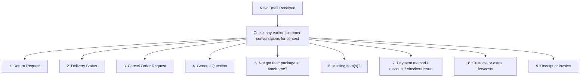
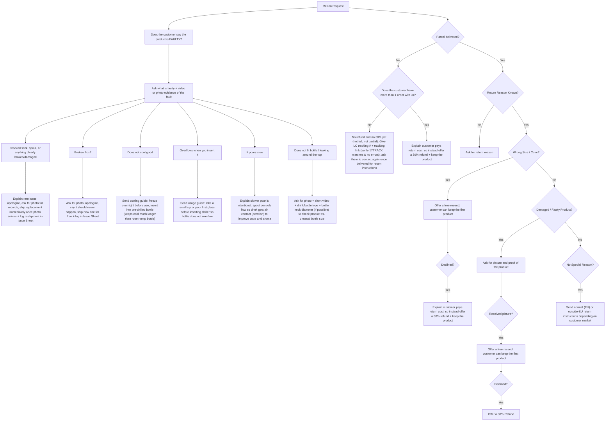
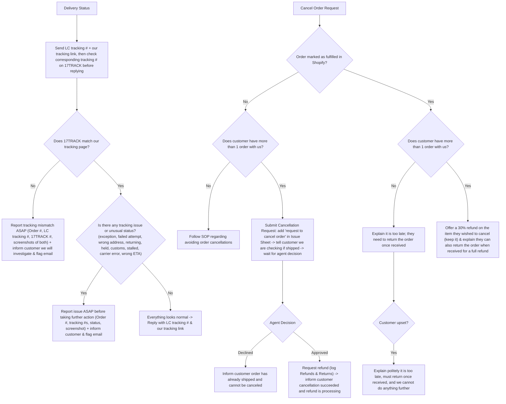
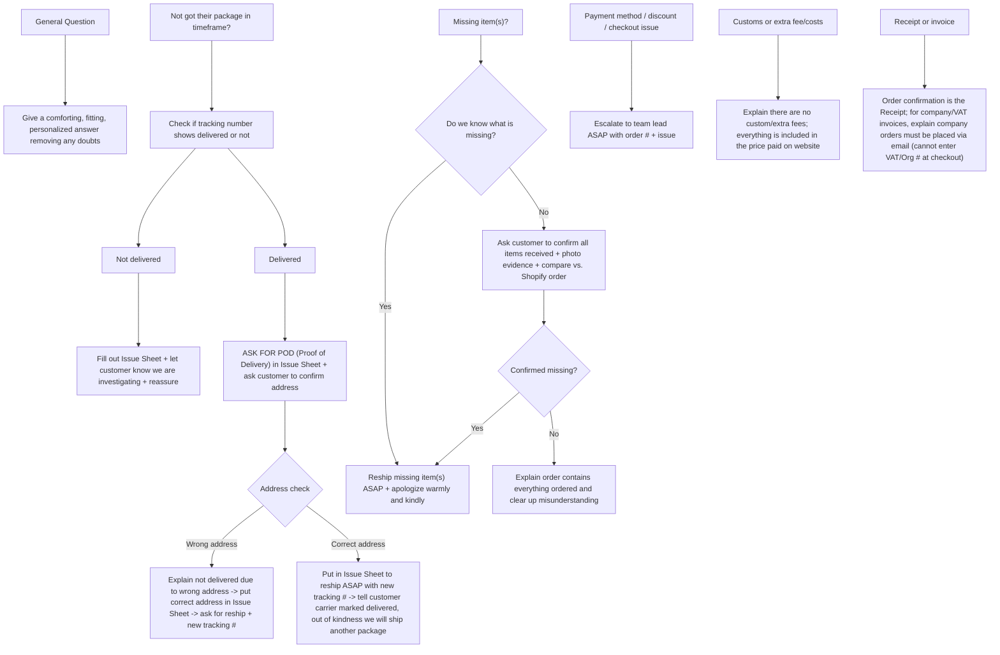

# Reference Case 1: E-Commerce Customer Support SOP & Miro Decision-Tree

> **Domain:** Multi-market DTC e-commerce support (Shopify + fulfillment agent + masked tracking)  
> **Pattern:** Always-Apply Rules -> Context Check -> Miro Decision-Tree Routing -> Dual-Sheet Logging

This reference documents a production-grade e-commerce Customer Support SOP modeled after a visual Miro decision board. It combines **global non-negotiable rules**, **9 deterministic ticket branches**, **localized templates**, and **mandatory dual-sheet logging** (`Issue Sheet` + `Refunds & Returns`).

---

## 1. Global Rules (Apply in Every Branch)

| Rule | Standard |
| :--- | :--- |
| **Tracking** | Only ever send the internal/masked `LC` tracking number and store tracking link. Never send the carrier's raw tracking number, never mention origin country (e.g., China), and never send a supplier document to a customer. |
| **Language** | Always reply in the exact language the customer is writing in, regardless of which market or inbox the email came from. Never default to English. |
| **The Product** | Never promise unverified specs (hours, degrees, etc.). If unsure whether a claim is true, ask the team lead; never invent it. |
| **Speed** | First reply within 24 hours, every market, every day. Any ticket older than 48 hours must be escalated to the team lead the same day. |
| **Money** | No refund of any kind while the parcel is still on its way. If the customer says the product is faulty, reship a new product for free. Full refund only after the return has arrived and been inspected. |
| **Logging** | Every case goes in the `Issue Sheet`. Returns and refunds go in `Refunds & Returns` as well. A perfect email with nothing logged is an unfinished job. |
| **When Solved** | If the customer is happy, ask for a Trustpilot review mentioning your name. |

---

## 2. Master Ticket Triage (Entry -> 9 Branches)



---

## 3. Return Request & Faulty Product Tree (Miro Top Branches)



---

## 4. Delivery Status & Cancel Order Request (Miro Middle Branches)



---

## 5. General, Missing Package (POD), Missing Items, Payment, Customs & Invoice (Miro Lower Branches)



---

## 6. Dual-Sheet Logging & SOP Checklist

1. **Issue Sheet (Operations / Fulfillment):** Log **every** case with its own distinct row and order number (`#XXXX`), tracking numbers, issue type, and required action:
   - Late order
   - Lost order
   - Wrong address
   - Delivery error
   - Refund approval needed
   - Return request
   - Product damaged
   - Missing item
   *(Write the problem in the sheet, tell the fulfillment agent what you need, and request any needed info such as POD.)*
2. **Refunds & Returns Sheet (Finance):** Log **every** return instruction sent, partial 30% refund, or full refund (never duplicate another order's row). A return request touches **both** sheets (`Issue Sheet` for the case, `Refunds & Returns` for the money).

---

## 7. Detailed Operational SOPs (Notion Reference)

### 7.1 Shipping Schedule, Order Status & Cancellations
- **Shipping Window:** Monday to Friday, `04:00-12:00 CET` (no weekend shipments).
- **Order Status:**
  - `Yellow` = Unfulfilled (not shipped yet).
  - `Grey` = Fulfilled / Distributed by Agent (considered **shipped**, even if tracking has not updated yet; can **never** be canceled).
- **Weekday Cancellation Delay Rule:** If a cancellation request arrives within 24 hours of the shipping window, **do not reply immediately**; wait until the order ships and turns `Grey`, then reply that it has already shipped.
- **Weekend Exception:** If the request arrives Friday evening or Saturday (`Yellow`), cancel it and log it in the `Issue Sheet` (if Sunday, hold/ignore as on weekdays). If `Grey`, reply immediately that it has already shipped.

### 7.2 Carrier & Delivery Windows (Verify on 17TRACK + Send Store Link Only)
- **Internal Check:** Always verify the corresponding tracking number on `https://www.17track.net/en` before replying.
- **Customer-Facing Tracking:** Only ever send the masked `LC-XXXX-XXXXX` number and the localized store tracking page (never send carrier links or raw carrier tracking numbers):

| Market | Typical Delivery Window (Work Days) | Store Tracking Path Pattern |
| :--- | :--- | :--- |
| **SE** (Sweden) | 5-12 work days | `/pages/spara-din-order` |
| **DK** (Denmark) | 8-10 work days | `/pages/spor-din-ordre` |
| **NO** (Norway) | 7-15 work days | `/pages/spor-din-ordre` |
| **NL / BE** | 5-10 work days | `/pages/volg-je-bestelling` |
| **FI** (Finland) | 5-12 work days | Store tracking page |
| **World / UK / US / CA** | Market standard | `/pages/track-your-order` |

### 7.3 The 4 Core Exception Playbooks
1. **Missing Item:** Open the order lines to verify what was ordered. **Always reship the missing part** (never refund instead). In the same email, ask for a photo of what they *did* receive (evidence for `Issue Sheet`), log under `Missing item`, and instruct fulfillment to send the missing part. Never question the customer.
2. **Damaged / Faulty Product:** If the fault is already described, do not ask them to describe it again. Require a **photo/video** first, and state in the same email: *once the photo arrives, we will ship a free replacement and you can keep the broken one*. Log under `Product damaged`. Never reship before receiving the photo; never refund instead of reshipping.
3. **30% Keep-It Offer:** Offer 30% back while keeping the item when the customer no longer wants it and the order is already shipped (`Grey`) or delivered. If declined, move to normal returns. **Never** offer it twice in the same thread; never refund 100% or cancel a `Grey` order.
4. **Delivered Not Received (POD):** Request Proof of Delivery (POD) **internally** in the `Issue Sheet` (never ask the customer for POD). In the same email, ask the customer to confirm their full delivery address so we can compare it against the order (do not promise a reship yet).
   - Wrong address -> explain address mismatch, log correct address in `Issue Sheet`, request reship + new tracking number.
   - Correct address -> log reship ASAP in `Issue Sheet` with new tracking number, explain carrier marked delivered and we are sending a replacement as a goodwill gesture.

### 7.4 Customer-Caused Reshipment Fee
Use when a package is returned/undeliverable due to customer error (missed pickup deadline, wrong/incomplete address):
1. Explain the delivery failed due to the address/pickup issue, and offer a **reduced reshipment fee** (~$8-$14) instead of placing a full-price new order.
2. Send the market-specific reshipment payment link and ask for the **new order number** once paid.
3. Verify payment + updated delivery address on the new order.
4. Instruct the shipping agent to **reship the original order** (using the original order number, not the fee order).

### 7.5 Return Sent but Never Arrived at Warehouse
1. Check where the carrier actually delivered it; state plainly if it was delivered somewhere other than the warehouse.
2. **No refund until the return arrives at the warehouse and is inspected** (never bend this rule, even if the customer threatens escalation).
3. Ask the customer for the shipping receipt / proof that they sent it to the correct return address, and instruct them to contact the carrier to trace it.
4. Log in **both** `Issue Sheet` and `Refunds & Returns`.

---

## 8. Sample Response Templates (Adapt & Translate to Customer's Language)

> **Important:** Always translate into the customer's exact language, keep tone calm and helpful, and replace `[placeholders]` with verified order facts.

### A. Delivery Status (Normal Tracking)
```text
Subject: Update on your order #[OrderNumber]

Hi [Name],

Thanks for reaching out! Your order is currently on its way.

You can track your parcel using your tracking code [LC-XXXX-XXXXX] on our tracking page here:
[Localized Store Tracking Link]

Let us know if you have any other questions!

Best regards,
[Brand Name]
```

### B. Cancellation Refusal (Order Already Shipped / Grey)
```text
Subject: Your cancellation request - Order #[OrderNumber]

Hi [Name],

Thank you for contacting us.

We are unable to cancel order #[OrderNumber] because it has already been shipped out. Once the parcel arrives, please reach out to us if you would still like to arrange a return.

Best regards,
[Brand Name]
```

### C. Damaged / Faulty Product (Photo Required Before Free Reship)
```text
Subject: Your order #[OrderNumber]

Hi [Name],

I am really sorry to hear that your item arrived damaged, and sorry for the inconvenience!

Could you please reply with a quick photo (or short video) showing the damage? We need this for our records, and as soon as we receive the photo, we will ship a brand-new replacement to you free of charge (you do not need to return the damaged one).

Best regards,
[Brand Name]
```

### D. Missing Item (Photo Evidence + Free Reship)
```text
Subject: Missing item in order #[OrderNumber]

Hi [Name],

I am so sorry that an item was missing from your package!

We will ship the missing item to you right away at no cost. Could you also send a quick photo of what you received in the parcel so we can attach it to our warehouse report?

Best regards,
[Brand Name]
```

### E. 30% Keep-It Offer (Shipped or Delivered Order)
```text
Subject: Your return request - Order #[OrderNumber]

Hi [Name],

Thank you for reaching out.

Because return shipping is covered by the customer, we can offer an easier option: we can issue a 30% refund right away and you can keep the product, so you do not have to pay for or arrange a return.

Would you like us to go ahead with the 30% refund, or would you prefer the return instructions instead?

Best regards,
[Brand Name]
```

### F. Delivered Not Received (POD + Address Confirmation)
```text
Subject: Delivery check - Order #[OrderNumber]

Hi [Name],

Thank you for letting us know. We are looking into this with our shipping partner right away.

To help us compare against your order details, could you please confirm your full delivery address (street, postal code, and city)? Once we hear back from you and our carrier, we will update you on the next step.

Best regards,
[Brand Name]
```

### G. EU Return Instructions
```text
Subject: Your return request - Order #[OrderNumber]

Hi [Name],

Thank you for reaching out. Here are the return instructions for order #[OrderNumber]:

Return Address:
[Warehouse Name / Receiver]
[Street Address]
[Postal Code & City, Country]
Phone: [Warehouse Phone]

Please make sure to:
- Ship with a tracking number (return shipping is covered by the customer).
- Include your order number (#[OrderNumber]) and full name on a note inside the package or written clearly on the outside.
- Refunds are processed within 5-10 business days after the return arrives at our warehouse and is inspected.

Feel free to reply with your return tracking number once shipped!

Best regards,
[Brand Name]
```

### H. Outside-EU Return Instructions (UK / US / CA)
```text
Subject: Your return request - Order #[OrderNumber]

Hi [Name],

Thank you for reaching out.

Since your return will be shipped from outside the EU to our warehouse in [Country], it must be declared correctly as "Returned goods - no commercial value" on the customs declaration. Incorrectly declared packages may be stopped in customs or returned to you.

Return address:
[Warehouse Name / Receiver]
[Street Address]
[Postal Code & City, Country]
Phone: [Warehouse Phone]

Please note:
- The return shipping cost is covered by the customer.
- Any customs or import fees related to the return are the responsibility of the customer.
- Mark the customs declaration as "Returned goods - no commercial value".
- Packages arriving with unpaid customs charges will be refused and no refund can be issued.
- If the package is stopped in customs and returned to you, no refund can be issued.
- The refund is processed only after the return has arrived at our address and been inspected (within 5-10 business days after arrival).

If you have any questions before shipping, we are happy to assist.

Kind regards,
[Brand Name]
```

### I. Customer-Caused Reshipment Fee
```text
Subject: Reshipment for order #[OrderNumber]

Hi [Name],

Your parcel for order #[OrderNumber] could not be delivered due to [missed pickup / incomplete address] and was returned.

Instead of placing a completely new order at full price, we can reship your original order if you cover the reduced reshipping fee here:
[Market-Specific Reshipment Payment Link]

Once you complete the payment, please reply with your new order number and confirm your full delivery address so we can arrange the reshipment right away.

Best regards,
[Brand Name]
```

### J. Return Sent but Never Arrived at Warehouse
```text
Subject: Update on your return - Order #[OrderNumber]

Hi [Name],

Thank you for following up.

We checked the tracking for your return, and it shows the parcel was delivered to [Location Shown by Carrier] rather than our warehouse address. Because we can only issue a refund once the return arrives at our warehouse and is inspected, we are unable to process the refund yet.

Could you please send us your shipping receipt showing the destination address you sent it to, and contact the carrier directly so they can trace where the parcel was delivered?

Best regards,
[Brand Name]
```

### K. Review + Bonus Ask (When Solved & Customer Is Happy)
*(Skip for markets without a live Trustpilot page, such as NL if not yet set up.)*
```text
I am happy we got this sorted!

If you are satisfied, a short Trustpilot review mentioning my name "[Your Name]" would really help me a lot, it only takes a minute. Thanks so much!
[Localized Trustpilot Link]
```
