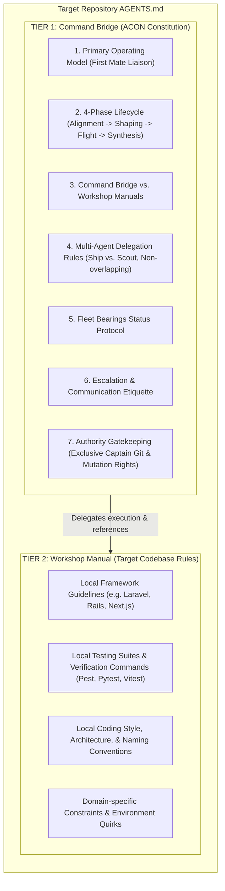
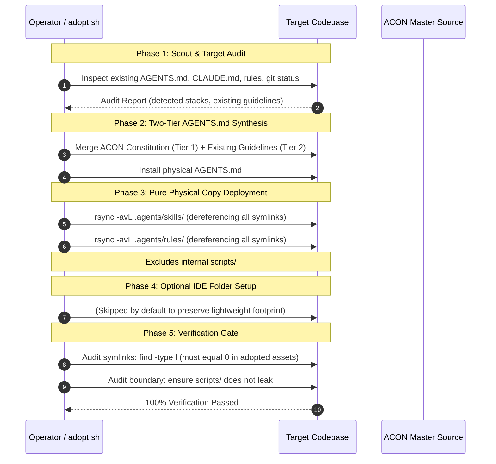

# ACON Repository Adoption & Synchronization (`adopt-acon`)

> **Firstmate Architectural Standard:** *"Talk to one agent. Ship with a crew."*  
> **The Universal Physical Copy Invariant:** *"Zero symlinks. 100% self-contained repositories."*  
> **The Strict Adoption Boundary:** *"Adopt conventions and skills only. Internal control plane scripts stay with the Control Plane."*

`adopt-acon` is the canonical adoption, bootstrapping, and synchronization engine for transferring the **ACON** (Agentic Conventions & Control Plane Network) operational conventions into any greenfield repository or brownfield legacy project.

It installs the complete **Agent Control Plane** constitution (`AGENTS.md`), the **36-skill** catalog (`.agents/skills/`) + 67 craft style presets, constitutional rules (`.agents/rules/`), and reference catalogs, readable contract specifications, crew briefs, and workflows (`.agents/reference/`) into the target repository—while rigorously preserving all existing codebase guidelines, framework conventions, and tooling commands verbatim.

---

## 1. Core Philosophy: Why Adopt ACON?

Modern software engineering with AI agents faces three fundamental dilemmas:

1. **The Single-Agent Bottleneck:** A single agent attempts to do everything in one blocking command thread—scouting, coding, testing, git mutations—locking the interface, losing architectural focus, and producing unreviewed code.
2. **The Fragmentation Trap:** Every project ends up with fragmented, conflicting agent rules (`.cursorrules`, `CLAUDE.md`, `copilot-instructions.md`, custom system prompts) with no unified task contract, no multi-agent delegation protocol, and no standardized status reporting.
3. **The Fragile Symlink Hazard:** When attempting to share skills or rules across repositories using symlinks, toolchains break. Windows environments fail to resolve POSIX symlinks, Docker build contexts reject dangling links, CI/CD runners produce missing-file errors, and git worktrees collide.

`adopt-acon` resolves all three challenges in a single, automated, fail-closed adoption lifecycle.

---

## 2. The Strict Adoption Boundary & Physical Copy Invariants

```
┌────────────────────────────────────────────────────────────────────────┐
│                   UNIVERSAL PHYSICAL COPY INVARIANT                    │
│                                                                        │
│   ❌ NO SYMLINKS IN ADOPTED REPOSITORIES (0 SYMLINKS TOLERATED)        │
│   ✅ 100% INDEPENDENT, FULLY SELF-CONTAINED PHYSICAL ARTIFACTS         │
│                                                                        │
│   • AGENTS.md         --> Real physical root constitution file         │
│   • .agents/skills/   --> Real physical copies of all domain skills    │
│   • .agents/rules/    --> Real physical copies of constitutional rules │
│   • .agents/reference/ --> Physical copies of contract specifications, crew, workflows, catalogs │
│   • .agents/reference/--> Real physical copies of reference catalogs   │
│                                                                        │
│   🚫 STRICTLY EXCLUDED FROM TARGET REPOSITORIES:                       │
│   • scripts/                   (Control plane scripts stay with ACON)  │
└────────────────────────────────────────────────────────────────────────┘
```

### The Strict Adoption Boundary Defined
Adopted repositories are **lightweight consumers** of ACON conventions and domain skills. They do not require adoption scripts or internal control plane tooling. All internal scripts and tooling remain strictly housed in the central ACON Control Plane repository.

When `adopt.sh` runs, it transfers **ONLY**:
1. `AGENTS.md` (Two-Tier Architecture: Command Bridge + Local Workshop Manual)
2. `.agents/skills/` (Domain skills dereferenced into physical directories, including `productivity/decision-gates`)
3. `.agents/rules/` (Constitutional rules dereferenced into physical files)
3. `.agents/reference/` (Reference catalogs, readable contract specifications in `reference/schemas/` including `decision-sheet.md`, crew briefs, and workflows)
5. `.agents/reference/` (Reference catalogs dereferenced into physical files)

And explicitly forbids copying:
- `scripts/`
- Any internal control plane scripts or tooling

### Why Symlinks Are Strictly Forbidden in Target Codebases
1. **Cross-Platform Portability (Windows & WSL):** Windows filesystems handle symlinks poorly, requiring developer mode or administrative elevation. Git checkouts on Windows often convert symlinks into useless plaintext files containing relative paths.
2. **Containerization & Cloud Sandboxes:** Docker containers and Kubernetes runner pods mount only the current workspace. Dangling symlinks pointing outside the workspace (or circular relative links) result in silent `ENOENT` (file not found) crashes inside agents.
3. **Git Worktree Isolation:** When agents spawn isolated worktrees (`git worktree add`), relative symlinks like `../../.agents/skills` break or traverse into parent directories unexpectedly.
4. **IDE Parsing Independence:** Physical directories avoid dependence on symlink traversal, but do not guarantee parsing, indexing or file-watch support. Verify the active reader's observed capabilities for the installed paths; use the [portable fleet contract](../../../reference/crew/README.md) for execution capabilities rather than treating file adoption as runtime compatibility certification.

---

## 3. The Two-Tier `AGENTS.md` Merge Architecture

When adopting ACON into an existing codebase (brownfield adoption), you must **never** clobber or erase the project's existing instructions, coding standards, or domain guidelines. 

ACON solves this through the **Two-Tier `AGENTS.md` Architecture**:



### Tier 1: The Command Bridge (Top)
The Command Bridge contains the complete, uncompromised ACON constitution:
- **First Mate Liaison Model:** One Captain, one primary assistant.
- **Delegation Boundary:** The Control Plane delegates project investigation, edits, builds/tests and git operations; bounded host/harness bootstrap is permitted by the current ACON constitution and is not project exploration.
- **Approval-First Dispatch:** Scope a bounded `Codebase Scout` when project exploration is needed, but obtain any missing launch approval before dispatch. Bounded runtime bootstrap does not authorize project inspection or execution.
- **Foreign Boundary Trigger:** Automatic delegation when inspecting external paths.
- **Task Contracts (`SHIP` vs. `SCOUT`):** Rigid boundary enforcement and verifiable test passes.
- **4-Section Bearings Digest:** Standardized status reporting.
- **Decision Gates Protocol:** Structured evaluation gates (`decision-gates`) and the readable normative [decision-sheet.md](../../../reference/schemas/decision-sheet.md) contract governing intake, shaping, and post-flight verification; the Markdown contract is not executable schema validation.
- **Exclusive Captain Authority:** Destructive actions and git commits require human authorization.

### Tier 2: The Workshop Manual (Bottom)
The Workshop Manual preserves the target repository's existing documentation verbatim under Section 3 and the document footer:
- Existing `AGENTS.md`, `CLAUDE.md`, or `.cursorrules` are extracted and placed under `## Local Workshop Manual: <Project Name>`.
- Existing framework guidelines remain 100% intact.
- Specialist subagents read Tier 2 to execute domain tasks according to local conventions, while the Control Plane operates under Tier 1.

---

## 4. The 5-Phase Adoption Lifecycle



### Phase 1: Scout & Target Audit
Before transferring any files, the target repository is inspected:
- Detect existing rule files: `AGENTS.md`, `CLAUDE.md`, `.cursorrules`, `.cursor/rules/`, `.claude/`.
- Detect technology stacks: `composer.json`, `package.json`, `pyproject.toml`, `go.mod`, `Cargo.toml`.
- Verify git status is clean or recorded.

### Phase 2: Two-Tier `AGENTS.md` Synthesis
- If target repository has an existing `AGENTS.md`:
  - Check if ACON constitution is already present.
  - If already present, update Tier 1 while preserving Tier 2.
  - If not present, prepend Tier 1 (ACON Constitution) and place existing content into Tier 2.
  - Add explicit cross-reference in Section 3 linking to the Local Workshop Manual.
- If target repository has no `AGENTS.md`:
  - Copy ACON's `AGENTS.md` directly.
- **Single Source of Truth & Compatibility Paths:** The physical root `AGENTS.md` remains canonical. `CLAUDE.md` is installed as a relative symlink to `AGENTS.md` (`CLAUDE.md -> AGENTS.md`), preventing duplicate rule content. Whether an active reader discovers either entry point and resolves the symlink requires observed capability evidence, not a branded runtime requirement.

### Phase 3: Pure Physical Copy Deployment
- Copy `.agents/skills/` physically using `rsync -avL`.
- Copy `.agents/rules/` physically using `rsync -avL`.
- Copy `.agents/reference/` (including `schemas/`, `crew/`, `workflows/`, and catalogs) physically using `rsync -avL`.
- **Strict Boundary Guard:** Explicitly exclude internal control plane scripts (`scripts/`).
- **Zero Shadow Folders:** Eliminates redundant `.claude/` and `.cursor/` symlink directories. The existing compatibility paths are the root `AGENTS.md` and `CLAUDE.md -> AGENTS.md`; reader support must be observed, not assumed for every harness.

### Phase 4: Verification Gate (Fail-Closed)
The adoption process runs an automated verification gate:
1. **Zero-Symlink Audit:**
   ```bash
   find "$TARGET/.agents" -type l
   ```
   If ANY symlink is detected in adopted assets, adoption FAILS immediately.
2. **Boundary Enforcement Audit:**
   ```bash
   test ! -e "$TARGET/scripts"
   ```
   Ensures internal control plane scripts were not leaked.
3. **Skill Catalog Integrity Check:**
   Counts installed skills to verify complete deployment.

---

## 5. Automated Tooling: `adopt.sh` CLI Reference

The automated adoption script is located at `scripts/adopt.sh`.

### Syntax
```bash
./scripts/adopt.sh [OPTIONS] <TARGET_DIRECTORY>
```

### Options & Flags
| Flag | Description |
| :--- | :--- |
| `<TARGET_DIRECTORY>` | Absolute or relative path to the target repository to adopt ACON into. |
| `-n, --dry-run` | Preview files to be created/updated without modifying the target. |
| `-f, --force` | Overwrite existing files or re-synthesize `AGENTS.md` without confirmation. |
| `-h, --help` | Display command usage and examples. |

### Example Invocations
```bash
# Adopt ACON into a target project:
./scripts/adopt.sh /home/user/my-project

# Preview adoption in dry-run mode:
./scripts/adopt.sh --dry-run /home/user/my-project

# Force update an already adopted project:
./scripts/adopt.sh --force /home/user/my-project
```

---

### Pane-pool policy and local session boundary

The user manually opens/resumes the ORCHESTRATOR; ACON never launches it from JSON. The portable session policy lives in the shared crew reference. Resolve actual execution surface and task-local capabilities, not provider brand. Establish Normal Agent versus ORCHESTRATOR before role-dependent action when unknown; approved handoff/existing verified role is sufficient.

Terminal/agent-CLI ORCHESTRATORS use separately opened persona-equipped peers, never native subagents, including after peer failure. Desktop/IDE surfaces unable to open pane-plus-agent-CLI peers may use isolated native subagents only when every required capability is evidenced AVAILABLE and the exact assignment is separately approved. Route by actual surface and task-local evidence, never brand; UNKNOWN is BLOCKED. Desktop/IDE native fallback requires all required capabilities AVAILABLE and separate assignment approval.

If role is unestablished, ask Normal Agent versus ORCHESTRATOR before role-dependent action. Verified role or approved handoff establishes it; do not ask assigned workers again. A Normal Agent never spawns crew or assumes orchestrator authority; it may perform its Captain-authorized bounded task or join by approved assignment.

The manually active ORCHESTRATOR owns ledger writes. It may appoint one bounded crew role for one exact delegated update under ORCHESTRATOR authority only while suspending its own writes; validate the result, then return write ownership to the ORCHESTRATOR before any further write. No concurrent writers or blanket crew permission. Prefer direct safe bootstrap initialization; delegate ledger bootstrap only when the exact safe bootstrap is evidenced, otherwise pause and request the smallest supported manual alternative.

On first terminal orchestrator run with no ledger, verify actual current identity and workspace, then initialize the existing minimal schema through the canonical race-resistant temp-write/rename procedure in the [portable fleet reference](../../../reference/crew/README.md#manual-orchestrator-session-ledger). Reject symlinks and preserve bytes on malformed/wrong-workspace/unknown-identity/permission/I/O failure; if safe host-supported no-follow/exclusive creation and verified-handle operations are unknown or unavailable, pause as BLOCKED. After each actual verified launch/join, register its existing identity and verified role/model/pane association before another launch; registration failure freezes further launches and reports the real live process without guessed rollback. Keep failed, unreachable or otherwise uncertain identity pending without duplication or guessed replacement. Completed crew CLIs remain alive, idle and registered by default. Retirement requires a separate explicit Captain instruction naming or unambiguously identifying the target crew; remove its ledger entry only after actual retirement is confirmed. Preserve saved conversations and panes unless separately authorized for deletion/closure. Count idle live CLIs against the approved mission ceiling; when full, queue/pause or seek Captain direction—never auto-quit, recycle or merge roles/waive review. Reuse an idle same-role conversation only for currently authorized work after refreshing its bounded brief and selected skills and verifying role, context, model, workspace and capabilities; never silently switch persona/model or reuse a writer context for reviewer work. Follow the [canonical retained-crew lifecycle](../../../reference/crew/README.md#manual-orchestrator-session-ledger). A first-run existing normal agent joins only after explicit Captain opt-in confirming identity/workspace, persona and available model/effort; preserve its live session. For relocation, use the canonical verified-owned-session and right-side-pane rule; update pane ID only after verified movement. Preserve the no-copy/no-secrets boundary and exact ignore paths; never blanket-ignore `.acon/`.

Preserve target `.gitignore` contents and append only `/.acon/sessions.json` and `/.acon/sessions.json.tmp` when absent; reject a symlink `.gitignore` (including dangling links) before target writes. Repeated adoption must not duplicate either exact line. Verify both exact patterns occur once and existing local ignore entries remain intact. Never blanket-ignore `.acon/` or replace local ignores. Prevent source ledger/IDs/provider state/credentials/internal scripts from being copied. The ledger is data, not consent. Existing Captain authorization, launch/skill preflight, task/message rules, workspace/worktree/reviewer isolation, compatibility paths, and G8/G9 remain binding. See the canonical [verified relocation contract](../../../reference/crew/README.md#host-neutral-orchestration). Documented host support is not smoke-tested behavior.

## 6. Adoption Checklist & Quality Invariants

When verifying an adopted repository, complete this checklist:

### Repository Adoption Checklist
- [ ] **Physical Copy & Symlink Standard:** No symlinks in `$TARGET/.agents` or `$TARGET/AGENTS.md`; `$TARGET/CLAUDE.md` symlinks cleanly to `AGENTS.md`.
- [ ] **Strict Boundary Enforced:** Internal ACON scripts from `scripts/` do NOT leak into `$TARGET`.
- [ ] **Two-Tier Constitution:** `$TARGET/AGENTS.md` contains Tier 1 (Command Bridge) at the top and Tier 2 (Workshop Manual) at the bottom.
- [ ] **Catalog Integrity:** All active skills exist physically under `$TARGET/.agents/skills/`.
- [ ] **Role-Bounded Execution:** A Normal Agent performs only its Captain-authorized bounded task and never spawns crew; an ORCHESTRATOR acts as Control Plane and delegates project investigation, edits, builds/tests and Git operations through the canonical surface route.

## Provenance and MIT notice

Compatibility prose is an ACON reconciliation informed by Fleet `docs/PHILOSOPHY.md`, revision `0af843fa2c92413ea16c50e50bd8a9e24f1d1995`. See the [local provenance and full MIT notice](../../../reference/crew/README.md#provenance-and-mit-notice). Adoption paths, physical-copy/symlink behavior, commands and existing scripts are unchanged; no source runtime is adopted.

## End provenance and MIT notice
